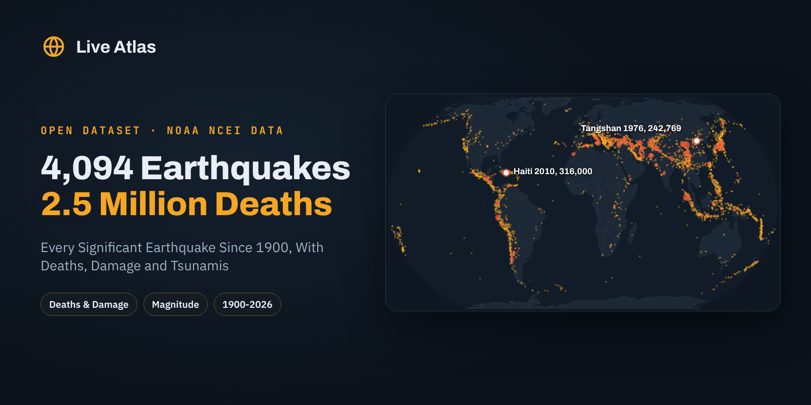

# Significant Earthquakes Since 1900



**English first, version française plus bas, resumen en español al final.**

## Every Significant Earthquake Since 1900, With Deaths, Damage and Tsunamis

Since 1900, at least **2.5 million people** have died in earthquakes, and more than half of them in just eight events. This dataset lists the **4,094 significant earthquakes** recorded worldwide from January 1900 to October 2026, one row per event, with magnitude, depth, intensity, deaths, injuries, damage, destroyed houses and whether the quake set off a tsunami.

An earthquake makes the list when it caused deaths or moderate damage (about 1 million dollars or more), reached magnitude 7.5, reached intensity X or set off a tsunami. That is the definition of the [NOAA NCEI Global Significant Earthquake Database](https://www.ngdc.noaa.gov/hazel/view/hazards/earthquake/search), downloaded through its official API and cleaned into one flat CSV. Each event with a page on [Live Atlas](https://www.liveatlas.earth/) links to its map, tsunami and history.

### The Headline Numbers

|  |  |
|---|---|
| Earthquakes, 1900 to October 2026 | 4,094 |
| Deaths with a recorded number | 2,546,313 |
| Events that set off a tsunami | 1,215 |
| Deadliest | Haiti 2010, 316,000 (NCEI figure) |
| Then | Tangshan 1976, 242,769 and Haiyuan 1920, 235,502 |
| Most events | China 383, Indonesia 324, Japan 263, Iran 226, USA 206 |
| Deadliest decade | 2000s, 463,007 deaths |

The toll does not follow magnitude. The 2010 Haiti earthquake was a magnitude 7.0, a size the world sees more than ten times a year, yet it sits at the top of the table because it struck right under Port-au-Prince. The 2011 Tohoku earthquake, a magnitude 9.1, killed far fewer people despite releasing more than a thousand times more energy, and most of its victims died in the tsunami, which `total_deaths` includes.

### Files

| file | content |
|---|---|
| `data/significant_earthquakes_since_1900.csv` | 4,094 rows, one per earthquake |
| `images/cover.png` | Cover image, 1600 × 800 |

### Columns

**significant_earthquakes_since_1900.csv**

| column | description |
|---|---|
| `ncei_id` | NCEI event id |
| `date` | Local catalog date, YYYY-MM-DD (month or day may be missing for old events) |
| `time_utc` | Origin time, UTC |
| `year` | Year |
| `country` | Country as listed by NCEI |
| `location` | Place description, country prefix removed |
| `latitude` | Epicenter latitude |
| `longitude` | Epicenter longitude |
| `depth_km` | Focal depth in km |
| `magnitude` | Magnitude (NCEI preferred value) |
| `mmi_intensity` | Maximum Modified Mercalli intensity (1-12) |
| `deaths` | Deaths from the shaking itself, when a number is known |
| `deaths_estimate` | NCEI order of magnitude when no number exists (few, some, many, very many) |
| `injuries` | Injuries from the shaking |
| `damage_million_usd` | Damage in millions of US dollars, value at the time |
| `houses_destroyed` | Houses destroyed |
| `houses_damaged` | Houses damaged |
| `total_deaths` | Deaths from the earthquake and its effects, tsunami, landslides and fires included |
| `total_deaths_estimate` | Order of magnitude when the total has no number |
| `total_injuries` | Total injuries, all effects |
| `total_damage_million_usd` | Total damage, all effects |
| `total_houses_destroyed` | Total houses destroyed, all effects |
| `caused_tsunami` | yes when NCEI links a tsunami event |
| `triggered_by_volcano` | yes when NCEI links a volcanic event |
| `liveatlas_url` | Event page on Live Atlas with map and context, when it exists (1,746 events) |

### Load It

```python
import pandas as pd

df = pd.read_csv("https://raw.githubusercontent.com/liveatlasearth/significant-earthquakes-since-1900/main/data/significant_earthquakes_since_1900.csv")
df.sort_values("total_deaths", ascending=False).head(10)[["date", "country", "location", "magnitude", "total_deaths"]]
```

### How It Was Built

All events from 1900 to 2026 were downloaded from the NCEI Hazard Service API (`/hazel/hazard-service/api/v1/earthquakes`) on 30 October 2026, page by page, then written to CSV with plain column names. Location strings were split from their country prefix. Nothing was filled in or estimated, empty means NCEI has no value.

### Checked Against The Source

Checked against the copy used on Live Atlas. All 4,087 events of the earlier copy are present, all 1,746 site pages match an NCEI id, and the reference magnitudes of Chile 1960 (9.5), Alaska 1964 (9.2), Sumatra 2004 (9.1), Tohoku 2011 (9.1) and Haiti 2010 (7.0) match.

### Read With Care

- **Death tolls are often disputed.** NCEI keeps one figure per event. For Haiti 2010 it lists 316,000, the Haitian government figure, while other estimates are far lower.
- **Older events are less complete.** Magnitude, depth or exact date can be missing before about 1960.
- **`deaths` versus `total_deaths`.** The first counts the shaking only, the second adds the tsunami, landslides and fires. Use `total_deaths` to rank disasters.
- **Damage is in dollars of the time**, not adjusted for inflation.

### License And Citation

**[CC BY 4.0](https://creativecommons.org/licenses/by/4.0/)**. Use it, share it and adapt it, commercially or not, and credit **Live Atlas** with a link to **[liveatlas.earth](https://www.liveatlas.earth/)**, along with the original source below.

```bibtex
@misc{liveatlas_significant_earthquakes_since_1900_2026,
  title  = {Significant Earthquakes Since 1900},
  author = {Ridge, Nathan and {Live Atlas}},
  year   = {2026},
  url    = {https://github.com/liveatlasearth/significant-earthquakes-since-1900},
  note   = {Dataset, version 1.0, built from NOAA NCEI data}
}
```

Sources. NOAA National Centers for Environmental Information (NCEI/WDS), Global Significant Earthquake Database, doi:10.7289/V5TD9V7K. US government work, public domain.

Companion datasets, **[Tsunamis Since 1900](https://github.com/liveatlasearth/tsunamis-since-1900)** ([Kaggle](https://www.kaggle.com/datasets/liveatlasearth/tsunamis-since-1900), [Hugging Face](https://huggingface.co/datasets/liveatlasearth/tsunamis-since-1900)), **[USGS Earthquake Catalogs In CSV](https://github.com/liveatlasearth/earthquake-catalogs)** ([Kaggle](https://www.kaggle.com/datasets/liveatlasearth/usgs-earthquake-catalogs), [Hugging Face](https://huggingface.co/datasets/liveatlasearth/usgs-earthquake-catalogs)), **[Tectonic Plates And Major Faults](https://github.com/liveatlasearth/tectonic-plates-and-faults)** ([Kaggle](https://www.kaggle.com/datasets/liveatlasearth/tectonic-plates-and-faults), [Hugging Face](https://huggingface.co/datasets/liveatlasearth/tectonic-plates-and-faults)).

Also on **[Kaggle](https://www.kaggle.com/datasets/liveatlasearth/significant-earthquakes-since-1900)**, with a starter notebook, and on **[Hugging Face](https://huggingface.co/datasets/liveatlasearth/significant-earthquakes-since-1900)**, ready for the `datasets` library.

See the latest earthquakes on a live map on **[Live Atlas](https://www.liveatlas.earth/earthquakes-today/)**.

---

## Version Française

### Les Séismes Marquants Depuis 1900

Depuis 1900, au moins **2,5 millions de personnes** sont mortes dans un séisme. Ce jeu de données liste les **4 094 séismes marquants** enregistrés dans le monde de janvier 1900 à octobre 2026, un séisme par ligne, avec la magnitude, la profondeur, l'intensité, les morts, les blessés, les dégâts, les maisons détruites et le tsunami éventuel. Un séisme y figure quand il a fait des morts ou des dégâts notables, atteint la magnitude 7,5 ou l'intensité X, ou déclenché un tsunami, selon la définition de la base NOAA NCEI.

- Le plus meurtrier reste Haïti en 2010, avec 316 000 morts selon NCEI, pour une magnitude de 7,0 seulement.
- La Chine compte le plus de séismes marquants (383) et le plus de morts (près de 715 000).
- La colonne `total_deaths` ajoute les morts du tsunami, des glissements de terrain et des incendies.

Licence CC BY 4.0, en citant **Live Atlas** avec un lien vers **[liveatlas.earth](https://www.liveatlas.earth/)** et la source d'origine.

### 🇪🇸 Resumen

4.094 terremotos significativos desde 1900 en todo el mundo, con muertos, heridos, daños y tsunamis, según la base de datos de la NOAA NCEI. El más mortífero sigue siendo Haití 2010. Licencia CC BY 4.0.

---

**Part of [Natural Hazards Datasets](https://github.com/liveatlasearth/natural-hazards-datasets)**, open data on earthquakes, volcanoes, storms, fires and space weather. Data by [Live Atlas](https://www.liveatlas.earth/), the free live map of the planet's hazards.
